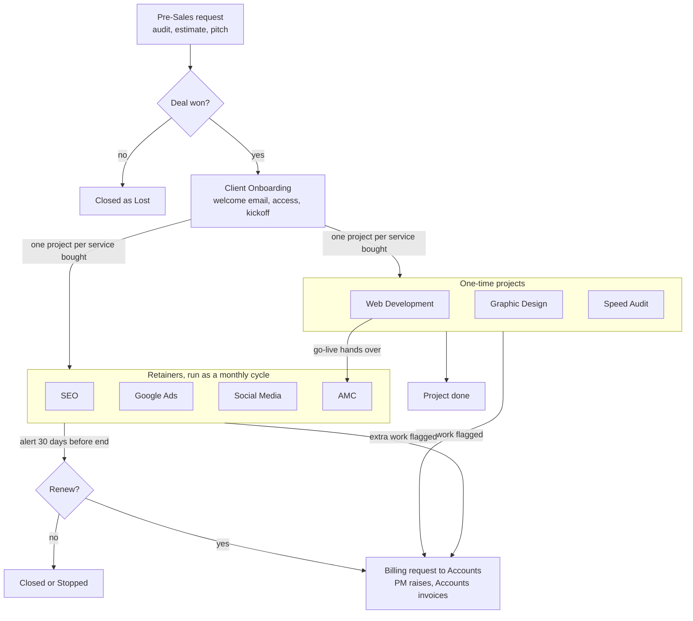

# SySpree Ops Hub - Product Requirements Document

Version 1.0 · 25 Oct 2026 · Owner: Caahill Murzello, Director of Operations
Live, commentable version: https://claude.ai/artifact/WDxzV6EoHG74VUeU8Smt42

## Overview and problem

SySpree Ops Hub replaces ClickUp as the one place where SySpree runs client delivery across its service departments. Client email and client WhatsApp groups are handled in the same window, and client data is locked to Project Managers.

What the ClickUp audit (25 Oct 2026) shows today:

- **Fragmented workflows.** All work sits in one Space with 7 folders and 14 lists. Each list has its own status set, and no two departments share a pipeline.
- **Manual triage of client input.** Clients send changes and data on WhatsApp groups and email. A person reads each message and copies it into the right task by hand. This is slow and changes get missed.
- **Exposed client data.** Client contact details, project value and even website and hosting logins sit in task descriptions that every member can read.
- **People baked into the process.** Staff names are part of status names (Mockup / Figma - Pranita, Implementation - Pooja, Create Baseline - Utkarsha). The workflow breaks whenever people change.
- **No client-level view.** A client buying several services appears as unlinked tasks in several lists. Hand-offs between departments happen by copying the task.
- **No capacity, leave or billing signals.** Nobody sees team load against leave, and Accounts learns about extra work or retainer renewals informally.

Cost of not solving: slower client response, missed change requests, unbilled additional work and a standing data exposure risk.

## Goals and non-goals

**Goals for v1**

1. Every client request from email or WhatsApp is logged against the right client, project and task within 4 working hours, without copy-paste.
2. Client contact details, email addresses and project value are visible only to Project Managers and Admin. Every other role sees masked data.
3. One standard pipeline per department, with a common set of status types, so dashboards compare departments like for like.
4. Project Managers and Team Leaders see team capacity, including approved leave, before they assign work.
5. Accounts is notified automatically for every billable additional task and every retainer or AMC renewal, and no billable item closes without a billing record.

**Non-goals for v1**

- **Client portal or client logins.** Clients keep using email and WhatsApp. A portal is a separate initiative.
- **Invoicing and accounting.** Accounts raises invoices in the existing accounting tool. Ops Hub only triggers and tracks the billing request.
- **Payroll and full HRMS.** HR records leave and availability only.
- **Time tracking for payroll.** Hours are estimates for capacity planning, not timesheets.
- **Replacing Google Workspace mailboxes.** Ops Hub connects to existing mailboxes; it does not host email.

## Current state baseline (ClickUp)

The new app must cover every department pipeline that exists in ClickUp today, then fix the gaps listed under the table. Counts are open tasks on 25 Oct 2026.

| Department (ClickUp folder / list) | Statuses today, in order | Open tasks | Fields in use |
| --- | --- | --- | --- |
| Pre-Sales: SEO Keyword Analysis, SEO Audit Requests, Web Efforts Estimate, SERP / Backlinks / GA Request, Google Ad Pitch Request | To Do, Complete | 38 | None |
| Client Onboarding (Welcome Onboard) | New Client - Sales Team, Email - Backend Team, Complete | 9 | None |
| Web Development | Open, Mockup / Figma - Pranita, In Progress / Development, In Review, Closed | 29 | Designer, Developer, Hold, Progress %, Progress Updates, Project Person, Technology |
| AMC (website maintenance) | To Do, Active AMC, Project Closed | 12 | Start Date, End Date, Progress %, Progress Updates |
| Speed / Responsiveness Audit | To Do, In Progress, Complete | 2 | None |
| SEO (standard) | Pre Sales SEO Audits, On Boarding, Consultation, Digital Strategy, Keyword Analysis, Keywords to Finalise, Create Baseline - Utkarsha, On Page, New Page Content, Pending or On Hold, Implementation - Pooja, Backlinks New, Project Stopped | 56 | Hold, Stage Changed |
| SEO (Advanced) | To Do, Welcome Onboard, Keyword Analysis, Tech Audit, Implementation - Pooja, On Page Creation, Backlinks, Stop Work, Complete | 63 | Hold, Stage Changed |
| Google Ads | To Do, Keyword Analysis Budgeting, Strategy Call, Account Setup, Landing Page / GTM, Campaign Setup, Ads Live, Project Stopped | 16 (+52 stopped) | Customer Success |
| Social Media | Active Clients, Stopped Work, Complete | 121 (102 stopped) | Designer, Stage Changed |
| Graphic Design | To Do, Complete | 8 | Designer |

**How a client moves today.** Sales closes the deal and creates a task in Welcome Onboard. The team sends a welcome email as a ClickUp comment with a questionnaire. The task is then moved or copied into the delivery list, where it stays open for the life of the engagement (one Social Media task holds 479 attachments). A website that goes live is copied into AMC; an SEO client running ads is copied into Google Ads.

**SEO delivery checklist (from the ClickUp template task).** Welcome email, GA and GSC access, sitemap, GA reporting, keyword suggestions, client-approved keywords, baseline report, on-page creation, grammar check, on-page implementation, implementation check, backlinks, blog keywords to content team 70 days after baseline.

**Gaps the new app must close**

- Status names carry people's names and must become assignees.
- Stopped work is handled three ways (an active status in Advanced SEO and Social Media, a closed status in SEO and Google Ads).
- Google Ads puts its working stages in the Done group, so they drop out of open-work reports.
- Several statuses hold no tasks (Tech Audit, Consultation, Digital Strategy, Create Baseline).
- One client appears in several lists with no link between tasks (e.g. shcw.com.au, theindusclub.com, jannatevents.com).
- Logins and client contact details live in task descriptions.
- There are no custom task types; every item is a plain task named after the client URL.

## User roles and permissions

Six roles, enforced on the server. Client contact data and project value are Project Manager and Admin only; every other role works with masked data.

| Role | Core job in Ops Hub |
| --- | --- |
| Admin (Director of Operations) | Owns setup, users, pipelines and the overview dashboard. Sees everything. |
| Project Manager (PM) | Owns client relationships. Creates projects, assigns work to teams, tracks progress, updates the client, checks capacity, raises billing requests. |
| Team Leader (TL) | Runs one department team. Plans the week, sets priority, assigns and reassigns tasks within the team. |
| Team Member | Works the tasks assigned to them. Updates status, progress and hours, replies on linked client threads (masked). |
| Accounts | Receives billing requests and renewal alerts, records invoice number and payment status. |
| HR | Records leave and availability so plans and capacity adjust automatically. |

**Access matrix**

| Data or action | Admin | PM | Team Leader | Team Member | Accounts | HR |
| --- | --- | --- | --- | --- | --- | --- |
| Client company name and website | Full | Full | Full | Full | Full | None |
| Client contact names, emails, phone numbers | Full | Full | Masked | Masked | Billing contact only | None |
| Project value, package price, retainer fee | Full | Full | None | None | Amount on billing requests only | None |
| Website / hosting / ad account credentials | Full | Full | Per-task grant from PM | Per-task grant from PM | None | None |
| Create and edit projects | Yes | Yes | No | No | No | No |
| Create and assign tasks | Yes | Any team | Own team | No (subtasks only) | No | No |
| Set priority and weekly plan | Yes | Yes | Own team | No | No | No |
| Update task status and progress | Yes | Yes | Own team | Own tasks | No | No |
| Client email and WhatsApp threads | Full | Full, unmasked | Linked projects, masked | Linked tasks, masked | Billing threads, masked | None |
| Send to client | Yes | Yes | Yes, from shared mailbox | Only if PM enables per project | Billing only | No |
| Billing requests | View | Create | Flag as billable | Flag as billable | Process | None |
| Leave records | View | View availability | View own team availability | Own only | None | Full |
| Capacity view | All | All | Own team | Own load | None | View |
| Dashboard | Company overview | Own projects | Own team | Own tasks | Billing | Leave |
| Users, roles, pipelines, integrations | Yes | No | No | No | No | No |

A person can hold more than one role (for example PM and Team Leader). Permissions are the union of the roles, but unmasked client data shows only on projects where that person is the assigned PM.

## Core data model

The client becomes the top-level record, with one project per service line, so one client buying SEO, Ads and AMC is one record with three linked projects instead of three unlinked tasks.

| Entity | What it holds | Key fields | Restricted fields (PM and Admin only) |
| --- | --- | --- | --- |
| Client | The company SySpree serves | Company name, website, country / market (IN, UAE/GCC, AU, UK, CA, US, SA, NZ), assigned PM, sales owner, status (Active, Paused, Churned), tags (reseller, monthly) | Contacts, GSTIN / tax details, total contract value |
| Contact | A person at the client | Role (decision maker, marketing, billing, technical) | Name, email, phone |
| Credential | Access to client systems | System (website admin, hosting, GA, GSC, GMB, Google Ads, Meta), label | Username, password, notes (encrypted vault) |
| Project | One service engagement for one client | Department, package (e.g. 30 keywords, 100 backlinks / month; 12 posts / month), type (one-time, retainer, AMC), start and end dates, renewal date, current stage, health (On track, At risk, Blocked), hold reason | Project value, billing cycle |
| Stage | A step in the department pipeline | Name, status type (Not started, Active, Waiting on client, On hold, Done, Stopped), default owner role, entry checklist, SLA days | None |
| Task | A unit of work inside a project | Title, type (deliverable, change request, report, fix, internal), assignee, team, priority (Urgent, High, Normal, Low), due date, estimate hours, progress %, status, billable flag, source (manual, email, WhatsApp) | None |
| Checklist item | A step inside a task or stage | Text, done, owner | None |
| Communication | One email or WhatsApp message | Channel, thread, direction, timestamp, body, attachments, linked client / project / task, triage state | Sender and recipient addresses and numbers (masked for others) |
| Billing request | A request from PM to Accounts | Client, project, reason (additional task, renewal, new package), description, linked tasks, status (Requested, Invoiced, Paid, Cancelled), invoice number | Amount (also visible to Accounts) |
| User | A SySpree team member | Roles, department team, weekly capacity hours, skills (designer, developer, SEO, ads, content) | None |
| Leave | Planned or unplanned absence | User, dates, half or full day, approved by | Reason (HR and Admin only) |
| Chat channel | Internal conversation | Type (direct, team, project), members | None |

## Department workflows

Each department gets one pipeline built from the stages it uses today, cleaned up. Every stage maps to one of six shared status types, so reports work across departments.

**Shared status types:** Not started, Active, Waiting on client, On hold, Done, Stopped. Waiting on client and On hold can be set at any stage and pause SLA timers. Stopped is the one terminal state for any project that ends early, with a required reason (client paused, client churned, non-payment, scope cancelled).

**Pipeline rules**

- Stage names never contain a person's name. The owner is the assignee.
- Admin can add, rename and reorder stages per department. Changes apply to new projects; live projects keep their history.
- Each stage can carry an entry checklist and an SLA in days. A project past its stage SLA turns At risk.
- Retainer departments (SEO, Google Ads, Social Media, AMC) run a monthly cycle after setup. Ops Hub creates each month's tasks from the package template on the cycle start date.

| Department | Setup stages (one-time) | Monthly cycle (retainers) | Exit |
| --- | --- | --- | --- |
| Pre-Sales | Requested, In progress, Internal review, Sent to sales | None | Won (creates onboarding) or Lost |
| Client Onboarding | Deal closed, Welcome email sent, Questionnaire and access received, Kickoff call done | None | Handed over (creates one project per service bought) |
| Web Development | Requirements and sitemap, Design (Figma), Client design approval, Development, Internal QA, Client review, Go live | None | Handed to AMC, or Done |
| AMC | Active | Product uploads, updates, fixes logged against monthly hours | Renewal due (auto, 30 days before end date), then Renewed or Closed |
| Speed / Responsiveness Audit | Requested, Audit, Fixes, Verification | None | Done |
| SEO (Standard and Advanced as package tiers) | Access (GA, GSC, GMB, sitemap), Keyword research, Keywords approved by client, Baseline report, Tech audit (Advanced only), On-page creation, On-page QA, On-page implementation, Implementation check | Backlinks quota, ranking report, blog keywords to content team after 70 days, monthly report | Stopped or contract end |
| Google Ads | Keyword analysis and budgeting, Strategy call, Account setup, Landing page / GTM, Campaign setup | Live optimisation, monthly report, budget review | Stopped or contract end |
| Social Media | Brand kit and access, Content strategy | Content calendar, creatives in production, client approval, scheduled / posted, monthly report | Stopped or contract end |
| Graphic Design | Brief, Concepts (options), Client feedback, Revisions, Final files delivered | None | Done |

Pre-Sales request types (SEO audit, keyword analysis, web estimate, SERP / backlinks / GA, Google Ads pitch) become a task type inside one Pre-Sales pipeline instead of five separate lists.

**Client lifecycle (every client follows one path, and billing fires at two points)**

Retainers run monthly until the renewal alert. Work flagged outside the package and a PM decision to renew both create a billing request for Accounts.

## Functional requirements

P0 ships in v1, P1 follows soon after, P2 is designed for but not built. Each requirement lists what must be true to accept it.

### 1. Projects and tasks

1. **P0 Department boards.** One board per department showing projects by stage, with list, board and calendar views. Filters: PM, assignee, client market, health, priority, package.
    - Accept when a PM can see all 9 department pipelines from the baseline and move a project between stages, with the move logged.
2. **P0 Client 360 page.** One page per client showing every linked project, open tasks, recent communications, billing requests and renewal dates.
    - Accept when a client with SEO, Google Ads and AMC shows all three projects on one page.
3. **P0 Hand-off between departments.** Onboarding hands a client to one or more departments; Web Development hands a live site to AMC. Hand-off creates the new project, carries over files and history, and notifies the receiving Team Leader.
    - Accept when no task has to be copied or moved by hand to change department.
4. **P0 Templates.** Admin defines per department the stage checklists and the monthly task set per package (e.g. SEO 30 keywords / 100 backlinks; Social 12 posts: 1 reel, 4 static, 2 email creatives).
    - Accept when starting a project from a package creates its setup tasks, and each monthly cycle creates that month's tasks on the cycle date.
5. **P0 Task management.** Tasks with type, assignee, priority, due date, estimate hours, progress %, status, checklist, subtasks, attachments, comments, dependencies and a billable flag.
    - Accept when a Team Member can update status and progress from their My Tasks view in two clicks or fewer.
6. **P0 Team Leader weekly planner.** A week view per team showing each member's assigned hours against available hours (after leave). TL drags tasks between members and days, and sets priority.
    - Accept when a TL can rebalance a member on leave without leaving the planner.
7. **P1 Recurring and dependent tasks.** Tasks that repeat (fortnightly ranking report) and tasks that unlock when a predecessor is done (blog keywords 70 days after baseline).
8. **P1 Health rules.** A project turns At risk when a stage passes its SLA, when no client reply arrives for 5 working days in Waiting on client, or when overdue tasks exceed 3.

### 2. Unified client inbox (email and WhatsApp)

1. **P0 Email connection.** Connect Google Workspace mailboxes (shared ones like support@ and development@, and each PM's mailbox) through the Gmail API. Two-way sync of threads, labels and attachments.
    - Accept when a reply sent from Gmail and one sent from Ops Hub both appear in the same thread in both places.
2. **P0 Send, receive, thread and search.** Inbox view with threads, compose, reply, reply-all, forward, attachments, templates (welcome email, approval request, monthly report) and full-text search by client, project, date, sender role, channel and keyword.
    - Accept when a user can find a 2023 email by client name and one keyword in under 10 seconds.
3. **P0 Auto-linking.** Each incoming message is linked to a client by sender email domain or WhatsApp number from the contact list. Unknown senders go to an Unmatched queue for the PM.
4. **P0 Triage into tasks.** Every client message gets a suggested type (change request, content or asset shared, approval, question, complaint, billing) and a suggested action (add to existing task, create new task, log approval). PM or TL confirms with one click; attachments are filed to the project.
    - Accept when a client change request becomes a task on the right project with the original message attached, in 3 clicks or fewer and no copy-paste.
5. **P0 Masking.** For every role except PM and Admin, client email addresses and phone numbers are masked everywhere: thread headers, recipient fields, message bodies, signatures, search results, exports and notifications. The sender shows as company and contact role, e.g. "Vastrado · Marketing contact". Replies are addressed by role; the server fills in the real address.
    - Accept when a Team Member cannot see a client address or number in the UI, the API response, the page source or a downloaded file.
6. **P0 WhatsApp channel (official API).** Connect a SySpree number on the WhatsApp Business Platform Cloud API. One-to-one client chats appear in the same inbox, with the same linking, triage and masking as email.
7. **P0 WhatsApp client groups (decision needed, see Open questions).** Meta's Groups API supports receiving group messages but only for Official Business Accounts, only for groups the business creates, and caps groups at 8 participants. Existing client groups made in the WhatsApp app cannot be connected. v1 therefore supports:
    - **Route A, target:** SySpree gets OBA status, Ops Hub creates one group per client (client contacts plus PM and up to 2 team members), clients join by invite link, and all messages flow into the inbox.
    - **Route B, interim:** team forwards client group messages to the SySpree business number, or uploads a WhatsApp chat export; Ops Hub parses sender, time, text and media and runs the same triage.
    - Unofficial WhatsApp Web bridges are excluded because they breach WhatsApp terms and risk the number being banned.
8. **P1 Response SLA.** Every inbound client message without a reply or a linked action within 4 working hours is flagged to the PM.
9. **P2 Other channels.** Microsoft 365 mailboxes, Slack Connect, website contact forms.

### 3. Capacity and leave

1. **P0 Leave records.** HR enters leave (full or half day, planned or sick) for any member. The reason is visible to HR and Admin only.
    - Accept when leave entered by HR reduces that member's available hours on every planner and capacity view within one minute.
2. **P0 Leave impact alert.** When leave is entered, the member's Team Leader and the PMs of affected projects get a list of tasks due during the leave, with a one-click reassign.
3. **P0 Capacity view.** For PMs and TLs: per member and per team, assigned estimate hours against available hours per week, with over-capacity shown in red. Assigning a task to an over-capacity member shows a warning.
4. **P1 Holiday calendars.** Office holidays per location (India first) reduce capacity for everyone.
5. **P2 Skill-based suggestions.** Suggest an assignee by skill and free capacity.

### 4. Billing triggers

1. **P0 Billable flag.** Any user can flag a task as additional work outside the package. The PM confirms or rejects it.
2. **P0 Billing request.** PM raises a billing request (reason, description, amount, linked tasks) and Accounts is notified in app and by email.
    - Accept when a confirmed billable task cannot be closed until its billing request exists.
3. **P0 Renewal alerts.** For every retainer and AMC, the PM and Accounts get alerts 30 and 7 days before the end date. The PM marks Renew or Close; Renew raises a billing request.
4. **P0 Accounts workspace.** Accounts sees all billing requests by status (Requested, Invoiced, Paid, Cancelled), records invoice number and dates, and can message the PM on each request.
5. **P1 Accounting export.** CSV export of billing requests, and later a Zoho Books or Tally connector.

### 5. Internal chat

1. **P0 Direct and group chat.** One-to-one chat, team channels per department, and an automatic channel per project with its members.
2. **P0 Context links.** Mention a user, task, project or client in chat; the link opens the record with the viewer's own permissions applied.
3. **P0 Notifications.** In-app, email digest and mobile push for mentions, assignments, due dates, client messages and billing requests, with per-user settings.
4. **P1 Chat search and file sharing.** Search chat history and share files into a task.
5. Clients are never members of internal chat.

### 6. Dashboards

1. **P0 Admin overview.** Active clients and projects by department and stage; projects At risk, On hold and Stopped this month; overdue tasks by team; team utilisation this week; unanswered client messages older than 4 working hours; billing requests pending; renewals due in 30 days.
2. **P0 Role dashboards.** PM (own clients and projects, waiting on client, renewals), TL (team load, overdue, this week's plan), Team Member (my tasks today and this week), Accounts (billing pipeline), HR (who is out this week and next).
3. **P1 Trends.** Month-on-month new clients, churn, stopped projects by reason, average time per stage, billable work raised.

### 7. Admin and migration

1. **P0 Users and roles.** Invite users, assign roles and teams, deactivate leavers. Deactivating a user reassigns their open tasks to the Team Leader.
2. **P0 ClickUp import.** Import clients, tasks, statuses, comments, attachments and activity from the ClickUp workspace, mapping each list to its new pipeline and stage.
3. **P0 Credential extraction.** During import, detect usernames and passwords in task descriptions, move them into the encrypted vault and remove them from the text.
4. **P0 Audit log.** Every view of unmasked contact data, project value or credentials, and every role change, is logged with user and time.

## User stories

**Project Manager**

- As a PM, I want every client email and WhatsApp message to land in one inbox already matched to the client, so I stop checking several phones and mailboxes.
- As a PM, I want to turn a client's change request into a task on the right project in one step, so nothing is lost between chat and delivery.
- As a PM, I want to see each team's free hours next week, including leave, before I commit a deadline to a client.
- As a PM, I want to raise a billing request from the tasks that triggered it, so Accounts bills the right amount without chasing me.
- As a PM, I want renewal alerts 30 days before a retainer ends, so I can renew before service lapses.
- As a PM, I want to give a developer access to one client's hosting login for one task, so credentials are not shared with the whole team.

**Team Leader**

- As a TL, I want a weekly planner of my team's tasks against their hours, so I can set priorities on Monday and rebalance midweek.
- As a TL, I want to be told when someone in my team goes on leave, with the tasks affected, so I can reassign them the same day.
- As a TL, I want to see client messages linked to my team's projects, with contact details masked, so my team has the context without the client's data.

**Team Member**

- As a team member, I want one list of my tasks for today and this week, sorted by priority and due date, so I know what to work on next.
- As a team member, I want to update status and progress % from my list, so my TL and PM see where things stand without asking.
- As a team member, I want to see the client's original message and attachments on my task, so I work from the exact request.
- As a team member, I want to flag work as outside the package, so additional effort gets billed.

**Accounts**

- As Accounts, I want a queue of billing requests with amount, reason and linked work, so I can invoice without asking the PM for details.
- As Accounts, I want renewal alerts for retainers and AMCs, so renewal invoices go out on time.

**HR**

- As HR, I want to record leave once and have every plan and capacity view update, so managers do not plan work for people who are out.

**Admin**

- As Admin, I want one dashboard of projects at risk, overdue work, unanswered client messages, utilisation and pending billing, so I can see the state of operations in one look.
- As Admin, I want an audit log of who viewed client contact data or credentials, so I can prove client data is protected.

**Edge cases**

- A message from an unknown number or email domain goes to the Unmatched queue, never to a random client.
- A client contact who emails from a personal address can be added to the client by the PM, which re-links past messages.
- A Team Member who also holds the PM role sees unmasked data only on the projects where they are the PM.

## Non-functional requirements

**Data protection**

- Masking and field restrictions are enforced in the API and database queries, not only in the UI. A restricted field is never sent to a browser that may not see it.
- Credentials are stored encrypted with a separate key, revealed one at a time, and every reveal is logged. Per-task grants expire when the task closes or after 7 days, whichever is first.
- Client data is handled in line with India's Digital Personal Data Protection Act, 2023, and with UAE, UK, Australian and Canadian client expectations; data residency is an open question.
- Exports (CSV, PDF) apply the same masking as the screen.

**Access and security**

- Google Workspace single sign-on, with two-factor authentication required for Admin, PM and Accounts.
- Sessions expire after 12 hours of inactivity. Deactivated users lose access immediately.
- Daily encrypted backups with 30-day retention; restore tested quarterly.

**Integrations**

- Gmail API for mail sync and send (OAuth per mailbox).
- WhatsApp Business Platform Cloud API through Meta directly or a Business Solution Provider that exposes the Groups API.
- ClickUp API for one-time migration.
- An AI model for message classification and suggested task text. Client data sent to it must not be used for training.

**Performance and availability**

- Inbound email and WhatsApp messages appear in the inbox within 60 seconds.
- Boards, inbox and search load in under 2 seconds for up to 1,000 clients, 50 users and 5 years of messages.
- 99.5% monthly uptime during 9:00 to 21:00 IST, Monday to Saturday.

**Usability**

- Web app first, responsive on mobile. Mobile push notifications through a PWA in v1, native apps later.
- English UI; dates in DD MMM YYYY; time zone per user (team in IST, clients across GST, AEST, GMT and North American zones).

## Success metrics

Targets are proposals to confirm against a 2-week baseline measured before launch. Review at 30 and 90 days after go-live.

| Metric | Type | How measured | Target at 90 days |
| --- | --- | --- | --- |
| Time from client message to linked task or reply | Leading | Inbox timestamps | Median under 4 working hours |
| Client messages triaged through Ops Hub (not copy-paste) | Leading | Share of inbound messages with a triage action | 90% |
| Weekly active users by role | Leading | Logins per week | 100% of PMs, TLs and team members |
| Tasks updated by the assignee at least weekly | Leading | Status or progress change per open task | 85% |
| Projects with no update in 14 days | Leading | Last activity date | Under 5% of active projects |
| Billable additional tasks with a billing request | Lagging | Confirmed billable tasks vs requests | 100% |
| Renewals invoiced before end date | Lagging | Renewal date vs invoice date | 95% |
| Overdue tasks per team | Lagging | Due date vs done date | Down 40% vs baseline |
| Unmasked client data views by non-PM roles | Guardrail | Audit log | Zero |
| ClickUp still in use for delivery | Guardrail | ClickUp activity after cutover | Zero after day 30 |

## Phasing and migration

Ship in three phases so the team moves off ClickUp as early as possible, with WhatsApp groups added once the official route is approved.

1. **Phase 1, MVP (replace ClickUp).** Roles, masking and audit log; department pipelines and templates; client 360; tasks and TL weekly planner; email inbox (Gmail); WhatsApp one-to-one and Route B forwarding; triage into tasks; leave and capacity; billing requests and renewal alerts; internal chat; admin and role dashboards; ClickUp import with credential extraction.
2. **Phase 2, automation.** WhatsApp client groups through Route A after OBA approval; response SLA; health rules; recurring and dependent tasks; trend dashboards; accounting export.
3. **Phase 3, extend.** Skill-based assignment, other mail providers, native mobile apps, client portal (separate PRD).

**Migration from ClickUp**

1. Agree the mapping of each ClickUp list and status to the new pipeline and stage (the baseline table is the starting point).
2. Import active clients and projects with comments, attachments and history. Archive stopped work (over 200 tasks) as read-only history.
3. Sweep descriptions for credentials and contact details, move them to the vault and client records, and strip them from task text.
4. Run Ops Hub and ClickUp side by side for 2 weeks, with all new client messages handled in Ops Hub.
5. Cut over, set ClickUp to read-only, and close it after 30 days.

## Open questions

| # | Question | Owner | Blocking |
| --- | --- | --- | --- |
| 1 | Will SySpree apply for WhatsApp Official Business Account status, and do most client groups fit within 8 participants? This decides Route A. | Admin | Yes |
| 2 | Build custom, or configure an existing platform and build only the inbox, masking and billing layers? | Admin, engineering | Yes |
| 3 | Target launch date and budget for Phase 1? | Admin | Yes |
| 4 | Should Accounts see the billing contact's email and the billing amount, or receive invoice details only from the PM? | Admin, Accounts | Yes |
| 5 | Does Sales need its own role to create deals and pre-sales requests, or does the PM do this? | Admin | No |
| 6 | Which mailboxes connect in Phase 1 (support@, development@, PM mailboxes), and do personal PM mailboxes need consent? | Admin, legal | No |
| 7 | Weekly capacity hours per member, and will teams estimate hours on every task? | Team Leaders | No |
| 8 | Hosting region and data residency for client data? | Engineering, legal | No |
| 9 | Which accounting tool does Accounts use (Zoho Books, Tally, other)? | Accounts | No |
| 10 | May Team Members ever email clients directly, or only TLs and PMs? Default in this PRD: off, enabled per project by the PM. | Admin | No |

## Sources

- SySpree ClickUp workspace, read-only audit of all 14 lists and their status settings, 25 Oct 2026.
- [The state of the WhatsApp Groups API in 2026](https://kapso.com/blog/whatsapp-groups-api-state-2026), Kapso, June 2026, summarising Meta's May 2026 Groups API documentation.
