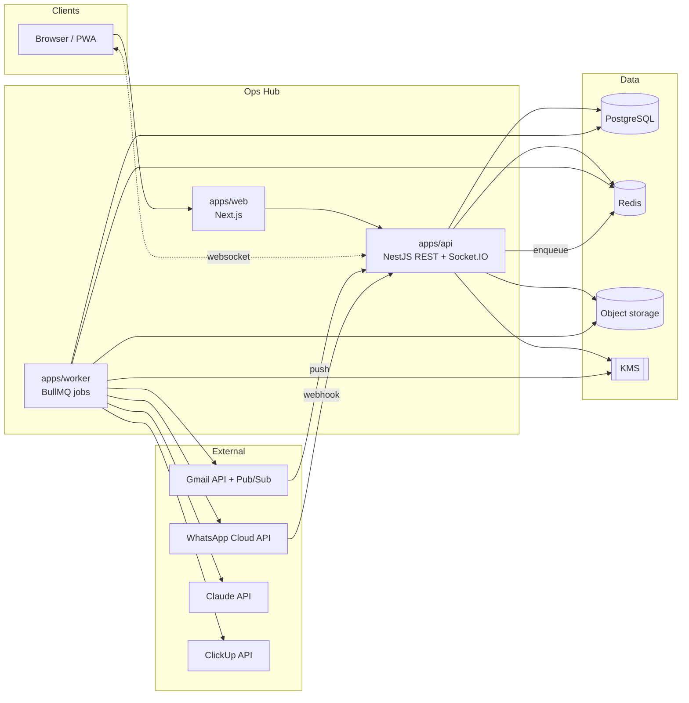
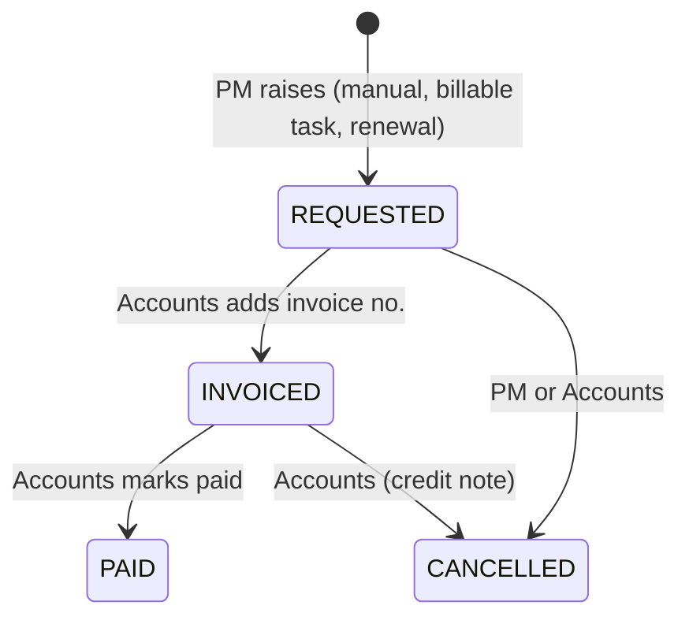

# SySpree Ops Hub - Technical Specification

Version 1.0 · 25 Oct 2026 · Status: Draft for engineering review
Reads with: `01_PRD.md` (what and why), `03_Hosting_Architecture_Guide.md` (where it runs), `05_AGENTS.md` (rules for coding agents), `DESIGN.md` (UI, supplied separately).

This spec covers Phase 1 (MVP) in full and marks Phase 2 items so the design leaves room for them. Where the PRD leaves a decision open, this spec states a default and flags it as **[Decision]**.

---

## 1. Stack decisions

| Layer | Choice | Why |
| --- | --- | --- |
| Language | TypeScript everywhere (strict mode) | One language for web, API, workers and shared types |
| Monorepo | pnpm workspaces + Turborepo | Shared types, one CI pipeline |
| Web app | Next.js (App Router), React, Tailwind CSS, component library per `DESIGN.md` | SSR for fast boards, PWA support |
| API | NestJS (REST, OpenAPI generated) | Guards and interceptors fit the role and masking model |
| Realtime | Socket.IO with Redis adapter | Chat, live board updates, inbox push |
| Database | PostgreSQL 17+ | Relational data, full-text search, JSONB for templates |
| ORM | Prisma | Typed queries, migrations |
| Queue and jobs | BullMQ on Redis 7 | Mail sync, WhatsApp intake, AI triage, reminders, monthly cycles |
| File storage | S3-compatible object store (AWS S3 or Cloudflare R2) | Attachments, exports, imports |
| Search | PostgreSQL full-text (`tsvector`) in v1; OpenSearch only if volume demands | Avoids a second datastore at 50 users |
| Auth | Google Workspace OIDC (SySpree domain only) | Staff already on Google Workspace |
| Secrets and keys | Cloud KMS for envelope encryption; secrets manager for app secrets | Vault and PII encryption |
| AI | Anthropic Claude API: `claude-haiku-5-5` for triage, `claude-sonnet-5-5` for low-confidence retries and summaries | Cheap high-volume classification, stronger fallback |
| Email | Gmail API + Google Cloud Pub/Sub push | Two-way sync with existing Workspace mailboxes |
| WhatsApp | WhatsApp Business Platform Cloud API (Meta direct or BSP) | Official, supported route |
| Observability | OpenTelemetry, Sentry, structured JSON logs | Traceable jobs and requests |

**[Decision]** PRD open question 2 (build vs configure an existing platform). This spec assumes a custom build because masking, the unified inbox and billing triggers cut across every module and are hard to retrofit onto an off-the-shelf PM tool.

---

## 2. Architecture overview



**Request path.** Browser calls `apps/web` (server components fetch from the API with the user's session). Every API response passes through the **Policy Serializer** (section 5) before it leaves the server.

**Webhook path.** Gmail Pub/Sub pushes and WhatsApp webhooks hit thin API endpoints that verify the signature, store the raw event, enqueue a job and return 200 within 2 seconds. Workers do the heavy work.

---

## 3. Repository layout

```
opshub/
  apps/
    web/                 Next.js app (UI only, no business rules)
    api/                 NestJS: REST, auth, policy, websockets, webhooks
    worker/              BullMQ processors and schedulers
  packages/
    db/                  Prisma schema, migrations, seed (departments, pipelines, templates)
    policy/              Roles, scopes, field policies, masking functions (single source of truth)
    shared/              Zod schemas, DTO types, enums, constants
    integrations/        gmail/, whatsapp/, claude/, clickup/ clients
    ui/                  Shared React components built to DESIGN.md
  tools/
    clickup-import/      One-time migration CLI
  infra/                 Terraform (see 03_Hosting_Architecture_Guide.md)
  docs/                  This pack (00 to 05) + DESIGN.md
  docker-compose.yml     Local Postgres, Redis, MinIO, Mailpit
  .env.example
  AGENTS.md              Copy of 05_AGENTS.md at repo root
```

Rule: business rules live in `apps/api` and `packages/policy`. `apps/web` never decides what a user may see.

---

## 4. Data model (Prisma)

Core schema. Field names are final unless review changes them. Encrypted columns hold ciphertext (`Bytes`) plus a key id.

```prisma
enum Role { ADMIN PM TEAM_LEADER TEAM_MEMBER ACCOUNTS HR }
enum Department { PRE_SALES ONBOARDING WEB_DEV AMC SPEED_AUDIT SEO GOOGLE_ADS SOCIAL_MEDIA GRAPHIC_DESIGN }
enum StatusType { NOT_STARTED ACTIVE WAITING_ON_CLIENT ON_HOLD DONE STOPPED }
enum ProjectType { ONE_TIME RETAINER AMC }
enum Health { ON_TRACK AT_RISK BLOCKED }
enum Priority { URGENT HIGH NORMAL LOW }
enum TaskType { DELIVERABLE CHANGE_REQUEST REPORT FIX INTERNAL PRESALES_REQUEST }
enum TaskSource { MANUAL EMAIL WHATSAPP TEMPLATE IMPORT }
enum Channel { EMAIL WHATSAPP }
enum Direction { INBOUND OUTBOUND }
enum TriageState { NEW SUGGESTED CONFIRMED DISMISSED UNMATCHED }
enum BillingReason { ADDITIONAL_TASK RENEWAL NEW_PACKAGE }
enum BillingStatus { REQUESTED INVOICED PAID CANCELLED }
enum ClientStatus { ACTIVE PAUSED CHURNED }
enum StopReason { CLIENT_PAUSED CLIENT_CHURNED NON_PAYMENT SCOPE_CANCELLED }

model User {
  id               String   @id @default(cuid())
  email            String   @unique            // SySpree staff email, not client PII
  name             String
  roles            Role[]
  teamId           String?
  team             Team?    @relation(fields: [teamId], references: [id])
  weeklyCapacityH  Decimal  @default(40)
  skills           String[]
  timezone         String   @default("Asia/Kolkata")
  active           Boolean  @default(true)
  createdAt        DateTime @default(now())
}

model Session {        // added in Phase 1A: server-side sessions
  id         String    @id   // sha256 of the cookie token
  userId     String
  createdAt  DateTime  @default(now())
  lastSeenAt DateTime  @default(now())
  revokedAt  DateTime?
  userAgent  String?
}

model Team {
  id           String     @id @default(cuid())
  name         String
  department   Department
  leaderId     String?
  members      User[]
}

model Client {
  id             String       @id @default(cuid())
  companyName    String
  website        String?
  market         String       // IN, AE, SA, AU, UK, CA, US, NZ ...
  status         ClientStatus @default(ACTIVE)
  pmId           String                       // assigned PM
  salesOwnerId   String?
  tags           String[]
  emailDomains   String[]                     // for auto-linking; restricted
  taxIdEnc       Bytes?                       // GSTIN etc, encrypted
  contractValue  Decimal?                     // restricted
  projects       Project[]
  contacts       Contact[]
  createdAt      DateTime     @default(now())
}

model Contact {
  id         String  @id @default(cuid())
  clientId   String
  client     Client  @relation(fields: [clientId], references: [id])
  role       String  // DECISION_MAKER, MARKETING, BILLING, TECHNICAL
  label      String  // safe display label, e.g. "Marketing contact"
  nameEnc    Bytes
  emailEnc   Bytes?
  phoneEnc   Bytes?
  emailHash  String? @unique   // HMAC-SHA256 for lookup without decrypting
  phoneHash  String? @unique
  keyId      String
}

model Credential {
  id         String   @id @default(cuid())
  clientId   String
  system     String   // WEBSITE_ADMIN, HOSTING, GA, GSC, GMB, GOOGLE_ADS, META
  label      String
  secretEnc  Bytes    // JSON {username, password, notes}, encrypted
  keyId      String
  grants     CredentialGrant[]
}

model CredentialGrant {
  id           String   @id @default(cuid())
  credentialId String
  credential   Credential @relation(fields: [credentialId], references: [id])
  userId       String
  taskId       String
  expiresAt    DateTime  // min(task close, now + 7 days)
  grantedById  String
  revokedAt    DateTime?
}

model Pipeline {
  id          String     @id @default(cuid())
  department  Department
  version     Int
  stages      Stage[]
  active      Boolean    @default(true)
  @@unique([department, version])
}

model Stage {
  id            String     @id @default(cuid())
  pipelineId    String
  pipeline      Pipeline   @relation(fields: [pipelineId], references: [id])
  name          String     // never a person's name (validated)
  order         Int
  statusType    StatusType
  phase         String     // SETUP or CYCLE
  slaDays       Int?
  checklist     Json       // [{text, ownerRole}]
}

model Package {
  id            String     @id @default(cuid())
  department    Department
  name          String     // "SEO 30 kw / 100 BL", "Social 12 posts"
  setupTasks    Json       // task templates
  cycleTasks    Json       // monthly task templates
  monthlyHours  Decimal?
}

model Project {
  id            String      @id @default(cuid())
  clientId      String
  client        Client      @relation(fields: [clientId], references: [id])
  department    Department
  pipelineId    String
  stageId       String
  packageId     String?
  type          ProjectType
  startDate     DateTime?
  endDate       DateTime?
  renewalDate   DateTime?
  cycleDay      Int?        // day of month the cycle starts
  health        Health      @default(ON_TRACK)
  holdReason    String?
  stopReason    StopReason?
  pmId          String
  teamId        String?
  value         Decimal?    // restricted
  billingCycle  String?     // restricted
  parentProjectId String?   // hand-off source (e.g. WEB_DEV -> AMC)
  tasks         Task[]
  stageEnteredAt DateTime   @default(now())
  createdAt     DateTime    @default(now())
}

model Task {
  id            String     @id @default(cuid())
  projectId     String
  project       Project    @relation(fields: [projectId], references: [id])
  parentTaskId  String?
  title         String
  type          TaskType
  description   String?    // rich text, PII-scrubbed on write
  assigneeId    String?
  teamId        String?
  priority      Priority   @default(NORMAL)
  dueDate       DateTime?
  plannedDate   DateTime?  // TL planner day
  estimateH     Decimal?
  progressPct   Int        @default(0)
  statusType    StatusType @default(NOT_STARTED)
  billable      Boolean    @default(false)
  billableConfirmed Boolean @default(false)
  source        TaskSource @default(MANUAL)
  sourceCommId  String?
  cycleMonth    String?    // "2026-11" for cycle tasks
  dependsOnId   String?
  unlockAfterDays Int?
  createdAt     DateTime   @default(now())
  completedAt   DateTime?
}

model Communication {
  id            String      @id @default(cuid())
  channel       Channel
  direction     Direction
  mailboxId     String?
  externalId    String      @unique // Gmail message id or WhatsApp wamid
  threadKey     String              // Gmail threadId or WA chat/group id
  clientId      String?
  projectId     String?
  taskId        String?
  contactId     String?
  fromEnc       Bytes                // address or number, encrypted
  toEnc         Bytes?
  subject       String?
  bodyMasked    String               // body with addresses and numbers redacted
  bodyEnc       Bytes                // original body, encrypted
  attachments   Json
  sentAt        DateTime
  triageState   TriageState @default(NEW)
  triage        Json?                // AI suggestion, see section 7.3
  searchVector  Unsupported("tsvector")?
  @@index([clientId, sentAt])
  @@index([threadKey])
}

model BillingRequest {
  id            String        @id @default(cuid())
  clientId      String
  projectId     String
  reason        BillingReason
  description   String
  amount        Decimal       // visible to PM, Admin, Accounts
  currency      String        @default("INR")
  status        BillingStatus @default(REQUESTED)
  invoiceNo     String?
  invoicedAt    DateTime?
  paidAt        DateTime?
  raisedById    String
  taskIds       String[]
  createdAt     DateTime      @default(now())
}

model Leave {
  id         String   @id @default(cuid())
  userId     String
  startDate  DateTime
  endDate    DateTime
  halfDay    Boolean  @default(false)
  kind       String   // PLANNED, SICK, OTHER
  reasonEnc  Bytes?   // HR and Admin only
  createdById String
}

model Holiday { id String @id @default(cuid()) date DateTime location String name String }

model ChatChannel {
  id        String @id @default(cuid())
  kind      String // DIRECT, TEAM, PROJECT
  projectId String?
  teamId    String?
  members   String[]
}

model ChatMessage {
  id        String   @id @default(cuid())
  channelId String
  authorId  String
  body      String
  mentions  Json
  createdAt DateTime @default(now())
}

model Mailbox {
  id          String  @id @default(cuid())
  address     String  @unique // SySpree mailbox
  ownerUserId String?          // null = shared mailbox
  oauthEnc    Bytes            // refresh token, encrypted
  historyId   String?
  watchExpiry DateTime?
}

model AuditLog {
  id        String   @id @default(cuid())
  actorId   String
  action    String   // VIEW_UNMASKED, REVEAL_CREDENTIAL, ROLE_CHANGE, EXPORT, ...
  entity    String
  entityId  String
  meta      Json
  at        DateTime @default(now())
  @@index([entity, entityId])
}

model ActivityLog {   // stage moves, status changes, assignments (business history)
  id        String   @id @default(cuid())
  actorId   String?
  projectId String?
  taskId    String?
  kind      String
  from      Json?
  to        Json?
  at        DateTime @default(now())
}
```

**Added in Phase 1B** (migration `phase_1b_projects_tasks`, additive only; full definitions in `packages/db/prisma/schema.prisma`):

| Change | Why |
| --- | --- |
| `Project.statusType` (defaults to the stage's status type), `Project.stopNote` | PRD: Waiting on client and On hold can be set at any stage; Stopped carries a reason and an optional note |
| `ChecklistItem` (`projectId` + `stageId` for stage checklists, or `taskId`) | Stage entry checklists are instantiated per project; task checklists (PRD 1.5) |
| `TaskComment` (body scrubbed with `maskBody` on write) | PRD 1.5 comments |
| `Attachment` (`storageKey` shared by copies made on hand-off) | PRD 1.3 "carries over files"; attachments by reference |
| `ProjectCycle` with unique (`projectId`, `cycleMonth`) | Makes `cycle.generate` idempotent (section 8) |
| `Package.active`, `Task.createdById`; relations Project to Stage, Package and Team, Task to assignee, Credential to Client | Catalog admin, audit of who created a task, joins for boards |

Task descriptions are scrubbed with `maskBody` on write, as are comments, so pasted client details never spread through work items. Attachments are stored on S3 in staging and production (`STORAGE_DRIVER=s3`) and on local disk for development machines without MinIO (`STORAGE_DRIVER=fs`, refused in production). Downloads are always `Content-Disposition: attachment` with `nosniff`.

**Added in Phase 1C** (migration `phase_1c_leave_capacity`, additive only):

| Change | Why |
| --- | --- |
| `User.location` (default `IN`) | Which office holidays reduce a person's capacity (section 9.1) |
| `Leave`: relation to `User`, `createdAt`, `updatedAt`, indexes on (`userId`, `startDate`) and the date range | Leave lists and capacity queries by week |
| `Holiday`: unique (`date`, `location`), `createdAt` | One holiday per day per office |
| `Notification` (`userId`, `kind`, `title`, `body`, `link`, `data`, `dedupeKey`, `readAt`), unique (`userId`, `dedupeKey`) | In-app leave impact alerts (PRD 3.2), one per person per leave. Phase 1F adds the digest, push and settings |
| Phase 1F: `Notification.category`, `emailedAt`, `pushedAt` | Category per alert kind (PRD 5.3) for the settings; the digest and push each claim a notification once |
| Phase 1F: `NotificationPreference` (`userId`, `category`, `email`, `push`) | A person's choices; missing rows use `DEFAULT_PREFERENCES` (`packages/shared/src/schemas-chat.ts`). In app is always on |
| Phase 1F: `PushSubscription` (`endpoint` unique, `p256dh`, `auth`, `lastUsedAt`) | Web push devices. A device the push service reports gone (404 or 410) is deleted |
| Phase 1F: `ChatChannel.name`, `directKey` (unique, the two user ids sorted), `projectId` and `teamId` unique; `ChatMember` (`channelId`, `userId`, `lastReadAt`); `ChatMessage` relation and index (`channelId`, `createdAt`) | One channel per project, per team and per pair of people. `ChatMember` holds DM membership and everyone's read position. `ChatChannel.members` is no longer used and goes in a later release (expand, then contract) |

Leave reasons are encrypted with the PII key (AAD `leave:<id>`). Notification text is written without client contact data, so it is safe to show and, later, to email.

**Added in Phase 1D** (migration `phase_1d_inbox`, additive only):

| Change | Why |
| --- | --- |
| `Communication`: `fromHash`, `ccEnc`, `subjectMasked`, `sentById`, `messageIdHeader`, `importId`, `linkMethod`, `category`, `triageOutcome`, `triagedById`, `triagedAt`, `createdAt`; relations to `Client` and `Mailbox`; indexes on triage state, sender hash, project, task and a GIN index on `searchVector` | Re-linking by sender without decrypting, reply threading, Accounts' billing scope, triage accuracy, search |
| `Mailbox`: `label`, `active`, `connectedById`, `lastSyncAt`, `syncError`, backfill progress, `createdAt` | Mailbox admin and resumable 3-year backfill |
| `WebhookEvent` (`payloadEnc`, `processedAt`, `attempts`) | WhatsApp payloads are stored encrypted between the verified webhook and the `wa.ingest` job |
| `WhatsAppImport` | Route B uploads: counts and audit |
| `Project.memberSendEnabled` (default false) | PRD OQ10: the PM lets Team Members email that client |

Addresses, numbers and bodies are encrypted with the PII key (AAD `communication:<id>`). Mailbox refresh tokens use the vault key (AAD `mailbox:<id>`). The search vector holds the masked subject, the masked body and the client's name, never the originals.

---

## 5. Authorization and masking

This is the most important part of the system. Every rule below must have an automated test (section 11).

### 5.1 Two checks on every request

1. **Action check (can this user do this?).** NestJS guard reads `@Requires(action, scope)` on each route, resolves the user's roles and scope, and denies by default.
2. **Field check (what may this user see?).** A global interceptor, the **Policy Serializer**, passes every response DTO through `packages/policy` before serialization. Restricted fields are removed, masked or replaced by labels. Controllers never return Prisma entities directly.

**As built (Phase 1A).**

- Every route carries exactly one of `@Requires(action, scope?)`, `@Authenticated()` (any signed-in user, e.g. `/me`, logout) or `@Public()` (login, webhooks, `/healthz`). The app refuses to start if a route has none (`apps/api/src/policy/route-audit.ts`).
- Action grants live in `packages/policy/src/actions.ts` (`ROLE_GRANTS`); the guard passes the granted scopes to the handler for SQL filtering.
- Controllers return `present(Dto, data, ctx)` built from `defineDto()` specs whose properties name rows in `fields.ts`. The serializer emits only declared properties and rejects any other response with `UNSERIALIZABLE_RESPONSE`, so a raw Prisma entity cannot reach the browser. `alt({ full, masked })` keeps encrypted originals undecrypted for viewers who may not see them.
- Fields marked `audit` in `fields.ts` write one `VIEW_UNMASKED` row per record when served in full.
- Sessions are server-side (`Session` model below): cookie holds a random token, the table stores its SHA-256. Idle timeout 12 h; deactivation revokes all sessions at once.
- Two-factor authentication for Admin, PM and Accounts is enforced by Google Workspace 2-Step Verification policy on those users' organisational unit; Google's ID token does not report it, so Ops Hub does not re-check it.

### 5.2 Scopes

| Scope | Meaning |
| --- | --- |
| `ALL` | Every record (Admin) |
| `OWN_CLIENTS` | Clients and projects where `pmId = user.id` |
| `OWN_TEAM` | Projects and tasks where `teamId` = user's team (Team Leader) |
| `ASSIGNED` | Tasks where `assigneeId = user.id`, plus their parent project in read-only summary |
| `BILLING` | Billing requests and their client company name (Accounts) |
| `PEOPLE` | Users and leave (HR) |

A PM sees unmasked client data only inside `OWN_CLIENTS`. On another PM's client they see masked data, matching the PRD edge case.

### 5.3 Field policy table

Implemented as a typed map in `packages/policy/fields.ts`. Values: `full`, `masked`, `label`, `amount`, `none`.

| Field | Admin | PM (own client) | PM (other client) | TL | Member | Accounts | HR |
| --- | --- | --- | --- | --- | --- | --- | --- |
| `client.companyName`, `website` | full | full | full | full | full | full | none |
| `client.contractValue`, `project.value`, `project.billingCycle` | full | full | none | none | none | none | none |
| `client.taxId` | full | full | none | none | none | full | none |
| `client.emailDomains` | full | full | none | none | none | none | none |
| `contact.name/email/phone` | full | full | label | label | label | billing contact only | none |
| `communication.from/to` (as built: also `cc`) | full | full | label | label | label | label | none |
| `communication.subject` (as built) | full | full | masked | masked | masked | masked | none |
| `communication.body` | full | full | masked | masked | masked | masked (billing only) | none |
| `billingRequest.amount` | full | full | none | none | none | amount | none |
| `leave.reason`, `leave.kind` (as built: whether leave was sick leave is treated like the reason) | full | none | none | none | none | none | full |
| `credential.secret` | full (reveal) | full (reveal) | none | grant only | grant only | none | none |

### 5.4 Masking functions

- `label(contact)` returns `"<Company> · <Contact label>"`, e.g. `Vastrado · Marketing contact`.
- `maskBody(text)` redacts, in order: email addresses, phone numbers (E.164 and local formats for IN, AE, SA, AU, UK, CA, US, NZ), URLs with credentials (`user:pass@`), and lines matching credential patterns (`password`, `pwd`, `pw:`, `user name`). Replacement tokens: `[email hidden]`, `[phone hidden]`, `[credential hidden]`.
- `bodyMasked` is computed at ingest and stored, so search and notifications only ever touch masked text. The encrypted original is decrypted only for `full` viewers, and each decrypt writes an `AuditLog` row (`VIEW_UNMASKED`).

### 5.5 Sending as a masked user

Non-PM users choose a recipient by **contact label**. The API resolves `contactId` to the real address server side at send time. The compose payload contains `contactIds`, never addresses. If a user types an address manually, the API rejects it unless the user has `full` on that client.

### 5.6 Where masking must also apply

Websocket events, push and email notifications, CSV and PDF exports, search results and snippets, AI prompts shown in the UI, error messages, application logs and Sentry breadcrumbs. Logging uses a redacting serializer that drops any field tagged `@Sensitive`.

As built (Phase 1F): internal chat is masked on write, like billing messages. `NotifyService` runs `maskBody` over every alert title and body as a backstop. `maskBody` hides addresses, numbers and logins, not names. A contact's name typed into free text (an email body, a chat message) stays readable to everyone who can see that text. **[Decision 10 Nov 2026]** Names in free text stay as written for now. Replacing the client's known contact names with their labels at ingest is a possible later change.

### 5.7 Credential vault

- Envelope encryption: a data key per record, wrapped by a KMS key dedicated to the vault (separate from the PII key).
- Reveal is a POST (`/credentials/:id/reveal`) that returns the secret once, never cached, and logs `REVEAL_CREDENTIAL`.
- Grants: PM grants a user access for one task. Grant expires at task completion or 7 days, whichever comes first. A nightly job and the task-close hook both revoke.

---

## 6. API design

REST, JSON, versioned under `/api/v1`. OpenAPI generated from NestJS decorators. Cursor pagination (`?cursor=&limit=`). All timestamps UTC ISO 8601; the UI converts to user time zone.

### 6.1 Resources (Phase 1)

| Area | Endpoints |
| --- | --- |
| Auth | `GET /auth/google`, `GET /auth/callback`, `POST /auth/logout`, `GET /me` |
| Clients | `GET/POST /clients`, `GET/PATCH /clients/:id`, `GET /clients/:id/overview` (client 360) |
| Contacts | `GET/POST /clients/:id/contacts`, `PATCH/DELETE /contacts/:id` |
| Credentials | `GET/POST /clients/:id/credentials`, `POST /credentials/:id/reveal`, `POST /credentials/:id/grants`, `DELETE /grants/:id` |
| Projects | `GET/POST /projects`, `GET/PATCH /projects/:id`, `POST /projects/:id/move-stage`, `POST /projects/:id/handoff`, `POST /projects/:id/stop` |
| Boards | `GET /boards/:department?view=board|list|calendar&filters=` |
| Tasks | `GET/POST /tasks`, `GET/PATCH /tasks/:id`, `POST /tasks/:id/comments`, `POST /tasks/:id/attachments`, `POST /tasks/:id/flag-billable`, `POST /tasks/:id/confirm-billable` |
| My work | `GET /me/tasks?range=today|week` |
| Planner | `GET /planner/:teamId?week=2026-W44`, `POST /planner/:teamId/moves` (batch reassign or reschedule) |
| Capacity | `GET /capacity?teamId=&week=` |
| Inbox | `GET /inbox/threads?filters=`, `GET /inbox/threads/:key`, `POST /inbox/send`, `POST /inbox/messages/:id/triage` (confirm, edit or dismiss), `GET /inbox/unmatched`, `POST /inbox/messages/:id/link` |
| WhatsApp import | `POST /whatsapp/imports` (Route B chat export upload) |
| Search | `GET /search?q=&type=communication|task|client` |
| Billing | `GET/POST /billing-requests`, `PATCH /billing-requests/:id` (Accounts: status, invoice fields) |
| Leave | `GET/POST /leave`, `PATCH/DELETE /leave/:id`, `GET /holidays` |
| Chat | `GET /chat/channels`, `GET /chat/channels/:id/messages`, `POST /chat/channels/:id/messages` |
| Dashboards | `GET /dashboards/admin`, `/dashboards/pm`, `/dashboards/tl`, `/dashboards/me`, `/dashboards/accounts`, `/dashboards/hr` |
| Admin | `GET/POST /users`, `PATCH /users/:id` (roles, team, capacity, deactivate), `GET/POST /pipelines`, `GET/POST /packages`, `GET/POST /mailboxes`, `GET /audit-log` |
| Webhooks | `POST /webhooks/gmail` (Pub/Sub push), `GET/POST /webhooks/whatsapp` (verify + events) |

**Added in Phase 1B:** `PATCH /projects/:id/checklist/:itemId` (stage checklist), `POST /projects/:id/attachments`, `POST /tasks/:id/checklist`, `PATCH|DELETE /checklist/:id`, `GET /attachments/:id` (download), `GET /pipelines`, `GET|POST /packages`, `PATCH /packages/:id`. `POST /pipelines` creates a new version and deactivates the previous one. `move-stage` answers `409 CHECKLIST_INCOMPLETE` when the current stage's checklist is open, unless `override: true` (logged). Hand-off returns the source project, closed at its first Done stage, with the new projects under `related`.

**Added in Phase 1C:** `GET /leave/:id/impact` (tasks due during a leave that the viewer can see, teammates' free hours and a suggested assignee per task), `POST /holidays` and `DELETE /holidays/:id` (HR and Admin), `GET /notifications`, `POST /notifications/:id/read`, `POST /notifications/read-all` (own alerts only). Actions: `leave.read` (Admin, PM and HR all; TL own team; Member own), `leave.manage` and `holiday.manage` (HR, Admin), `capacity.read` (Admin, PM, HR all; TL own team; Member own; Accounts none), `planner.read` and `planner.manage` (Admin, PM all; TL own team). `GET /capacity` also takes `userId`, which the UI uses for the assign warning. `POST /planner/:teamId/moves` takes up to 50 moves (`assigneeId`, `plannedDate`, `priority`), keeps tasks and assignees inside the team, logs `TASK_PLANNED`, and returns the updated week with `warnings` (`OVER_CAPACITY`, `ON_LEAVE`); it never blocks a move.

**Added in Phase 1D:**
- Inbox routes: `GET /inbox/threads?view=all|triage|unmatched|sent&channel=&clientId=&projectId=&before=` (threads, newest first, in scope) and `GET /inbox/threads/:key`.
- `POST /inbox/messages/:id/triage` takes `{decision: CONFIRM|DISMISS}`; confirming takes optional edits to category, action, project, task, title, priority, assignee and due date.
- `POST /inbox/messages/:id/link` takes `{clientId, saveAsContact?}`.
- `GET /inbox/messages/:id/attachments/:index` always downloads, never opens inline.
- `POST /inbox/send` takes JSON, or multipart with `payload` and `files`. Fields:
  - `channel` and `mode` (`NEW`, `REPLY`, `REPLY_ALL` or `FORWARD`);
  - `contactIds`, `ccContactIds`, and `toSender` (reply to the sender without the viewer handling the address);
  - `addresses`, accepted only from Admin and the client's PM;
  - `template`, for WhatsApp outside the 24-hour window.
- `GET /inbox/settings` returns the integration modes and the approved WhatsApp templates.
- Read state: `POST /inbox/threads/:key/read` records when the viewer opened a thread (table `ThreadRead`). Messages and threads carry `unread`: a message from someone else that arrived after that time. In a thread never opened, only its latest message counts. Each person's read state is their own.
- Mailboxes:
  - `GET /mailboxes` lists the ones the viewer may send from; `?manage=true` lists all (Admin).
  - `POST /mailboxes` adds a mailbox directly, fake mode only. `PATCH /mailboxes/:id`, `POST /mailboxes/:id/sync`, `POST /mailboxes/:id/backfill`.
  - `GET /mailboxes/connect` starts Google consent and `GET /mailboxes/oauth/callback` completes it.
- Webhooks are under `/api/v1/webhooks/`.
- Dev only: `POST /dev/inbox/simulate` delivers a client message through the same verified webhook paths.
- Actions:
  - `inbox.read`: Admin and PM all; TL own team; Member assigned; Accounts billing.
  - Visibility is by thread for email: a TL, Member or Accounts who can see one message of an email thread sees the whole thread, masked. A client's follow-up therefore shows before anyone triages it. WhatsApp one-to-one chats stay message by message, because each is one person's whole history across topics (fixed 10 Nov 2026).
  - `inbox.triage`: Admin, PM, and TL for their own team.
  - `inbox.link`: Admin and PM.
  - `inbox.send`: as `inbox.read`. A TL, Member or Accounts sends from shared mailboxes only, a Member only where `memberSendEnabled`, and Accounts only on billing threads.
  - `inbox.import`: Admin, PM, and TL for their own team.
  - `mailbox.manage`: Admin.

**Added in Phase 1F:**
- Chat (everyone signed in; what they can open is membership, below): `GET /chat/channels`, `POST /chat/direct` `{userId}`, `GET /chat/channels/:id/messages?before=&limit=`, `POST /chat/channels/:id/messages` `{body}`, `POST /chat/channels/:id/read`, `GET /chat/mention-options?q=`.
  - Membership is derived. A project channel belongs to the project's PM, its team and team leader, and anyone assigned a task on it, while the project is open. A team channel belongs to the team and its leader. A direct message belongs to its two people. Admin has no special access to channels; nobody reads a channel they are not in. Channels outside a person's membership answer 404.
  - Mentions are tokens in the body: `@[Label](user:<id>)` or `#[Label](task|project|client:<id>)`. On every read, and in each live event, the label is replaced by what that reader may see, using their own scopes. Where they cannot open the record it reads "no access" and has no link. The typeahead offers only records the writer can open.
  - On write, the text around tokens goes through `maskBody`. A token label that `maskBody` would change is dropped. Mentioned members get a `MENTION` alert that names the channel but not the text.
- Notifications: `GET /notifications/settings`, `PUT /notifications/settings` `{preferences: [{category, email, push}]}`, `POST` and `DELETE /notifications/push-subscriptions`, `POST /notifications/test` (always pushed, whatever the settings). New alerts: `ASSIGNED` (task create or reassign, planner moves), `CLIENT_MESSAGE` (to the client's PM, one per thread, with the contact label and masked subject), `MENTION`, `DUE` (worker, 08:30 IST).
- Dashboards: `GET /dashboards/admin|pm|tl|me|accounts|hr`. Actions `dashboard.admin` (Admin), `dashboard.pm` (PM own clients), `dashboard.tl` (TL own team), `dashboard.accounts` (Accounts billing), `dashboard.hr` (HR people); `/dashboards/me` is open to everyone signed in. Every count comes from the same scoped queries as the lists behind it. "Unanswered" is an inbound client message with no reply in its thread after 4 working hours (Mon to Sat, 09:00 to 18:00 IST, `workingHoursBetween`).
- Dev only: `GET /dev/mail` (the signed-in person's own digest emails in `LOCAL_MAIL_DIR`) and `POST /dev/mail/digest` (sends the digest now).

Actions added to `packages/policy/src/actions.ts`: `client.manage`, `credential.read|manage|reveal`, `project.read|manage`, `task.read|create|update`, `pipeline.read|manage`. Records outside a role's scope answer 404, not 403, so their existence is not revealed.

### 6.2 Websocket events

Namespace `/rt`, rooms per user, team, project and chat channel. Events: `task.updated`, `project.stage_changed`, `inbox.message_new`, `inbox.triage_suggested`, `chat.message_new`, `billing.request_new`, `leave.created`, `notification.new`. Payloads pass through the Policy Serializer for the receiving user, so each socket gets its own masked copy.

As built (Phase 1F):
- Path `/api/v1/rt/socket.io`, websocket transport. The handshake must carry the session cookie and come from `APP_URL` or `API_URL`; anything else is disconnected.
- One room per user (`user:<id>`), and nothing else. Each event is built and serialized for its one recipient (`RealtimeService.emitTo`), so there is no shared room that could carry someone else's view. Unmasked fields sent over a socket are audit logged with path `socket:<event>`.
- Events so far: `notification.new`, `chat.message_new` (the message with the reader's mention labels) and `inbox.message_new` (that reader's masked thread row, sent to everyone whose scope reaches the message). The rest arrive with the screens that need them.
- With Redis the API uses the Socket.IO Redis adapter, so any API instance reaches any user. Without it, one process.
- The browser connects to `REALTIME_URL`. Locally that defaults to `API_URL`, because the Next.js rewrite does not carry websockets. In production it is the app's own origin, where the load balancer routes `/api/*` to the API.
- Notifications the worker writes (renewal alerts, due reminders) get no live event: they appear on the next page load, and their push goes out within a minute (`notify.push`).
- The masking suite (`apps/api/test/masking/sockets.test.ts`) opens a socket per role, triggers every event with Demo Co's contact details, numbers and a login in the text, and checks each payload against the same needles as the GET crawl.

### 6.3 Errors

`{ "error": { "code": "FORBIDDEN_FIELD", "message": "...", "requestId": "..." } }`. Never echo restricted values in errors.

---

## 7. Integrations

### 7.1 Gmail

- **Auth.** OAuth per mailbox with scope `https://www.googleapis.com/auth/gmail.modify`. Shared mailboxes are connected by an Admin who has delegated access. Refresh tokens are stored encrypted on `Mailbox`.
- **Push.** `users.watch` to a Pub/Sub topic; Pub/Sub push subscription to `/webhooks/gmail`. Watches expire, so a daily job renews each one.
- **Sync.** On push, worker calls `users.history.list` from the stored `historyId`, fetches new messages, stores them as `Communication`, and runs linking and triage. A full backfill job imports history (default: last 3 years, **[Decision]**).
- **Send.** Build MIME in the worker, set `In-Reply-To` and `References` to keep threading, send via `users.messages.send` with `threadId`. Sent copy is stored from the API response.
- **Linking.** Sender address → `emailHash` lookup on `Contact`; else sender domain → `Client.emailDomains`; else `UNMATCHED`.

As built (Phase 1D):
- Clients live in `packages/integrations/src/gmail`. The live one calls the Gmail REST API through `google-auth-library` with each mailbox's refresh token. The fake keeps mailboxes in memory, and the inbox simulator delivers into it.
- The Pub/Sub push is checked for its OIDC token (audience `GMAIL_PUBSUB_AUDIENCE`, default the webhook URL, and the service account `GMAIL_PUBSUB_SERVICE_ACCOUNT`) before anything else.
- Linking order is contact hash, then domain, then a linked message in the same thread. Webmail domains never link by domain.
- Mail where every party is SySpree (allowed domains and connected mailboxes) is not stored.
- Outbound mail carries `In-Reply-To` and the Gmail `threadId`, so replies thread on both sides.

### 7.2 WhatsApp

- **Cloud API.** Webhook verification with the hub challenge on `GET /webhooks/whatsapp`; every `POST` is verified with the `X-Hub-Signature-256` HMAC using the app secret before anything is stored.
- **One-to-one (Phase 1).** Inbound messages become `Communication` with `channel = WHATSAPP`, `threadKey` = client number hash. Media is downloaded by the worker and stored in object storage. Outbound replies inside the customer service window are free-form; outside it, approved templates are required.
- **Route B import (Phase 1).** Upload of a WhatsApp chat export (`.txt` or `.zip` with media). Parser handles both 12h and 24h timestamp formats and multi-line messages, maps sender names or numbers to contacts, de-duplicates by hash of (sender, timestamp, text), then runs triage.
- **Route A groups (Phase 2, needs OBA).** Ops Hub creates the group via the Groups API, sends the invite link to client contacts 1:1, and receives group messages through the same webhook. Design constraint: max 8 participants per group, so default membership is client contacts + PM + up to 2 team members. Build behind a feature flag `wa_groups`.

As built (Phase 1D):
- One-to-one threads are keyed `wa:<number hash>`. A free-form reply is allowed for 24 hours after the client's last message; after that the API answers `422 OUTSIDE_WINDOW` unless an approved template from `WHATSAPP_TEMPLATES` is used.
- Route B threads are keyed `wa-group:<hash of client and chat name>`. Senders are matched to the client's contacts by number or saved name, and to staff by name; staff messages are outbound.
- Imported messages from the last 14 days are triaged. Older ones are history.
- The parser covers Android and iOS layouts and .zip exports with media; the fixture is `fixtures/whatsapp/sample-export.txt`.

### 7.3 AI triage (Claude)

- **Input.** `bodyMasked` (never the raw body), subject, channel, the client's open projects (id, department, stage, package) and the 10 most recent open tasks per project (id, title, type).
- **Output.** Strict JSON validated with Zod:

```json
{
  "category": "CHANGE_REQUEST | ASSET_SHARED | APPROVAL | QUESTION | COMPLAINT | BILLING | OTHER",
  "projectId": "string | null",
  "action": "ATTACH_TO_TASK | CREATE_TASK | LOG_APPROVAL | NONE",
  "taskId": "string | null",
  "suggestedTitle": "string",
  "suggestedPriority": "URGENT | HIGH | NORMAL | LOW",
  "summary": "string, max 200 chars",
  "confidence": 0.0
}
```

- **Model routing.** `claude-haiku-5-5` first. If `confidence < 0.6` or JSON fails validation, retry once with `claude-sonnet-5-5`. Still failing: `SUGGESTED` with empty fields for manual triage.
- **Human in the loop.** Suggestions never create tasks on their own. PM or TL confirms, edits or dismisses (PRD: 3 clicks or fewer). Confirmations and edits are stored to measure accuracy.
- **Data handling.** API key in the secrets manager; review the provider's commercial data-use and retention terms before go-live (PRD NFR: client data must not be used for training).

As built (Phase 1D): `packages/integrations/src/claude/triage.ts` calls `@anthropic-ai/sdk` with `messages.parse` and structured output (`zodOutputFormat`), effort `low`.
- Ids the model returns are kept only if they belong to the client's own projects and tasks; anything else is dropped and the action downgraded.
- A refusal or invalid output counts as a failed attempt.
- Below 0.6 twice, the better low-confidence suggestion is kept rather than nothing.
- `AI_MODE=fake` uses keyword rules for local runs and tests.
- `triageOutcome` records confirm or dismiss, the action, the model, and which suggested fields the person changed.

### 7.4 ClickUp import (one-time)

CLI in `tools/clickup-import`, using the ClickUp API v2 with a personal token. Dry-run mode prints the mapping report without writing.

Workspace (team) id `3715573`, Space "SySpree's Backend Team" id `3796574`.

| ClickUp folder | Folder id | List | List id | Target department | Notes |
| --- | --- | --- | --- | --- | --- |
| PRE SALES | 3581491 | SEO - Keyword Analysis | 9708948 | PRE_SALES | task type PRESALES_REQUEST, subtype keyword analysis |
| PRE SALES | 3581491 | SEO AUDIT REQUESTS | 181273685 | PRE_SALES | subtype SEO audit |
| PRE SALES | 3581491 | WEB - Efforts Estimate | 199413361 | PRE_SALES | subtype web estimate |
| PRE SALES | 3581491 | SERP, Backlinks, GA Request | 193331004 | PRE_SALES | subtype SERP / backlinks / GA |
| PRE SALES | 3581491 | Google Ad - Pitch Request | 901606772483 | PRE_SALES | subtype ads pitch |
| Welcome Onboard | 109276020 | List | 181231740 | ONBOARDING | |
| Development | 3581492 | Web Development | 7777694 | WEB_DEV | |
| Development | 3581492 | AMC | 11936099 | AMC | Start Date / End Date fields → project dates |
| Development | 3581492 | Speed Audit Responsiveness Audit | 901606861968 | SPEED_AUDIT | |
| SEO | 109275962 | SEO | 49349407 | SEO | package tier Standard |
| SEO | 109275962 | Advanced seo | 11948175 | SEO | package tier Advanced |
| Google Ads | 5484153 | List | 9802117 | GOOGLE_ADS | |
| Social Media | 5487761 | List | 9808851 | SOCIAL_MEDIA | |
| Graphic | 121405219 | List | 205319158 | GRAPHIC_DESIGN | |

List ids taken from ClickUp view URLs on 25 Oct 2026. The import CLI must re-read the hierarchy (`GET /team/{team_id}/space`, `/space/{id}/folder`, `/folder/{id}/list`) and stop if an id no longer matches.

**Status mapping (old → new stage, status type).** Stored as `tools/clickup-import/mapping.yaml`, reviewed by Admin before the real run. Highlights:

| ClickUp status | New stage | Status type |
| --- | --- | --- |
| New Client - Sales Team | Onboarding: Deal closed | ACTIVE |
| Email - Backend Team | Onboarding: Welcome email sent | ACTIVE |
| Open | Web Dev: Requirements and sitemap | NOT_STARTED |
| Mockup / Figma - Pranita | Web Dev: Design (Figma), assignee = Pranita | ACTIVE |
| In Progress / Development | Web Dev: Development | ACTIVE |
| In Review | Web Dev: Client review | WAITING_ON_CLIENT |
| Active AMC | AMC: Active | ACTIVE |
| Keyword Analysis | SEO: Keyword research | ACTIVE |
| Keywords to Finalise | SEO: Keywords approved by client | WAITING_ON_CLIENT |
| Create Baseline - Utkarsha | SEO: Baseline report, assignee = Utkarsha | ACTIVE |
| On Page / On Page Creation | SEO: On-page creation | ACTIVE |
| Implementation - Pooja / Implementation - (Pooja) | SEO: On-page implementation, assignee = Pooja | ACTIVE |
| Backlinks / Backlinks New | SEO: cycle (Backlinks quota) | ACTIVE |
| Pending or On Hold | current stage kept | ON_HOLD |
| Stop Work / Stopped Work / Project Stopped | current stage kept | STOPPED (reason from tags or "Unknown") |
| Strategy Call ... Ads Live | Google Ads stage of same name | ACTIVE (not DONE) |
| Active Clients | Social Media: cycle | ACTIVE |
| Complete / Closed / Project Closed | last stage | DONE |

**Client de-duplication.** Normalise task names that are URLs (strip protocol, `www.`, trailing slash, path) and group by domain. Same domain in several lists = one `Client` with several `Project`s (e.g. `shcw.com.au` appears in AMC twice and Google Ads). Name-only tasks are matched by fuzzy company name and reviewed in the dry-run report.

**PII and credential sweep.** Before writing a description: extract emails and phones into `Contact` (encrypted), extract credential blocks (patterns: `password`, `pw`, `pwd`, `user name`, `username`, `hosting`, `login`) into `Credential` (encrypted), and replace them in text with `[moved to vault]` or `[contact saved]`. The report lists every extraction for PM review.

As built (Phase 1B, dry run only): detection reuses `findSensitive` from `packages/policy` (the same patterns as `maskBody`). The dry-run report gives each extraction as a masked preview (`p***@domain`, last two phone digits, credential length), so the report files never hold the values themselves. It also writes `projects.csv`, the per-task mapping with assignee hints taken from status names. Subtasks are counted and later imported as tasks on their parent's project. Write mode arrives in Phase 1G.

**Attachments.** Download via the attachment URL, upload to object storage, keep original filename and upload date. Large tasks (one Social Media task has 479 files) are processed in batches with resumable checkpoints.

**Archive.** Stopped and closed tasks import as read-only history (`STOPPED` / `DONE`), excluded from boards by default.

---

## 8. Background jobs

| Job | Trigger | What it does |
| --- | --- | --- |
| `gmail.sync` | Pub/Sub push, plus every 5 min safety poll | History sync, store, link, enqueue triage |
| `gmail.watch.renew` | Daily 02:00 IST | Renew Gmail watches |
| `gmail.backfill` | Admin action | Import historic mail per mailbox |
| `wa.ingest` | Webhook | Store message, fetch media, link, enqueue triage |
| `wa.import` | Upload | Parse chat export (Route B) |
| `triage.classify` | After ingest | Claude classification, store suggestion, notify PM/TL |
| `cycle.generate` | Daily 00:30 IST | Create monthly cycle tasks for projects whose `cycleDay` is today |
| `tasks.unlock` | Hourly | Release dependent tasks after `unlockAfterDays` |
| `renewal.alerts` | Daily 09:00 IST | 30-day and 7-day alerts to PM and Accounts |
| `health.evaluate` | Hourly | SLA breach, waiting-on-client over 5 working days, overdue count over 3 → AT_RISK |
| `sla.response` (P1) | Every 15 min | Flag inbound messages with no reply or action after 4 working hours |
| `grants.expire` | Hourly | Revoke expired credential grants |
| `leave.impact` | On leave create | Find tasks due during leave, notify TL and PMs. As built: the API runs it inline after each leave create, change or delete; the worker job reruns it (`pnpm jobs:run leave.impact <leaveId>`) |
| `digest.email` | Daily 18:30 IST | Per-user notification digest |
| `due.reminders` | Daily 08:30 IST | Tasks due today and overdue, one alert per assignee (added in Phase 1F) |
| `notify.push` | Every minute | Push for alerts not yet pushed (added in Phase 1F) |
| `search.reindex` | On write + nightly | Refresh `tsvector` columns |

All jobs are idempotent (keyed by external id or by `projectId + cycleMonth`), retried with exponential backoff, and land in a dead-letter queue visible on the Admin page.

As built (Phase 1F), in the worker:
- `digest.email` daily at 18:30 IST: one email per person listing unread, not yet emailed alerts from the last 7 days in categories they get by email. Every pending alert is then marked emailed, so a digest never repeats. `MAIL_MODE=file` writes `.eml` and `.json` files to `LOCAL_MAIL_DIR`; `smtp` sends through `SMTP_URL` (production refuses `file`).
- `due.reminders` daily at 08:30 IST: one `DUE` alert per assignee per day ("2 tasks due today, 1 overdue").
- `notify.push` every minute: catch-up push for alerts not yet pushed (the worker's own, and any the API could not send). The API pushes the alerts it writes straight away.
- Push uses VAPID (`PUSH_VAPID_PUBLIC_KEY`, `PUSH_VAPID_PRIVATE_KEY`). Without the keys, and in tests, a fake sender records what it would send. Push carries the alert's title, body and link only, all written masked.

As built (Phase 1D): the inbox jobs run in the API process (`apps/api/src/jobs`), because they need the PII key and file storage: `gmail.sync`, `gmail.poll` every 5 minutes, `gmail.watch.renew`, `gmail.backfill`, `wa.ingest` and `triage.classify`. They run on BullMQ queue `opshub-inbox`, with retries and the dead-letter queue, when Redis is reachable. Without Redis (local machines, tests) they run in-process straight away, and there is no schedule; use Admin > Mailboxes > Sync now. `search.reindex` runs in the worker, nightly at 03:00 IST.

---

## 9. Core business rules

### 9.1 Capacity

```
available(user, week) = weeklyCapacityH
                        - sum(leave days in week x dailyHours)       // half day = 0.5
                        - holidays(location, week) x dailyHours
dailyHours = weeklyCapacityH / working days per week (default 6, Mon to Sat) [Decision]
assigned(user, week)  = sum(estimateH of open tasks with plannedDate or dueDate in week)
utilisation           = assigned / available
```

Over 100% shows red and triggers a warning on assign. Tasks without an estimate count as 0 and are listed as "unestimated" on the planner.

As built (Phase 1C), in `packages/shared/src/capacity.ts`:
- Weeks are ISO weeks (`2026-W46`), Monday to Sunday, in IST. The planner shows all seven days; Sunday has no hours.
- A task counts on its `plannedDate` if set, otherwise on its `dueDate`. Open statuses only.
- A day lost to both leave and a holiday counts once. Half days are single-day leave.
- Holidays apply by `User.location`.
- `utilisation` is null when no hours are available but work is assigned; that counts as over capacity.
- Over capacity, and placing work on someone's full-day leave, produce warnings, never blocks.

### 9.2 Stage moves

- A move writes `ActivityLog` and resets `stageEnteredAt`.
- Moving forward checks the stage's entry checklist; incomplete items warn but do not block (PM override is logged).
- `STOPPED` requires `stopReason`. `ON_HOLD` and `WAITING_ON_CLIENT` pause SLA timers.

### 9.3 Hand-off

`POST /projects/:id/handoff { toDepartment, packageId }` creates the new project with `parentProjectId`, copies attachments by reference, links communications, notifies the receiving TL. Onboarding hand-off can create several projects in one call.

### 9.4 Billing



A task with `billableConfirmed = true` cannot move to `DONE` unless a `BillingRequest` lists its id.

As built (Phase 1E):
- **Endpoints.**
  - `POST /tasks/:id/flag-billable` (anyone who can see the task) and `POST /tasks/:id/confirm-billable` (`CONFIRM` or `REJECT`, the client's PM).
  - `GET/POST /billing-requests`, `GET /billing-requests/:id` (with linked tasks, messages, the billing contact and what the viewer may do), `PATCH /billing-requests/:id`, `POST /billing-requests/:id/messages`.
  - `GET /renewals?within=30`, and `POST /projects/:id/renewal` (`RENEW` with new end date and amount, or `CLOSE`).
- **Actions.**
  - `billing.read`: Admin all; PM own clients; Accounts BILLING (every request).
  - `billing.create`: Admin; PM own clients.
  - `billing.update`: Admin; PM own clients; Accounts.
  - `renewal.read`: Admin; PM own clients; Accounts every retainer and AMC.
- **Transitions.**
  - Requested to Invoiced (invoice number required, invoice date defaults to today) to Paid; Accounts or Admin.
  - Requested to Cancelled by the PM, with a reason.
  - Requested or Invoiced to Cancelled by Accounts (a credit note once invoiced).
  - Anything else answers `422 INVALID_TRANSITION`. Closing a confirmed billable task that no live request lists answers `422 BILLING_REQUEST_REQUIRED`.
- **Schema** (migration `phase_1e_billing`):
  - `BillingRequest` gains relations to `Client` and `Project`, `cancelledAt`, `cancelReason`, `updatedAt` and indexes.
  - Its `renewalKey` (project and term end) is unique, so a term is renewed once.
  - A new `BillingMessage` table holds request messages, scrubbed with `maskBody`.
- **Field policy.** `billingRequest.*` and `billingMessage.*` are full for Admin, the client's PM and Accounts, none for others; `billingRequest.amount` keeps its 5.3 row. No billing DTO has the project value.
- **`renewal.alerts`** lives in `packages/db` and runs in the worker at 09:00 IST. It works on the term end (renewal date, else end date), alerts at 30 and 7 days with catch-up, and keys each alert per person, project, term and stage.

---

## 10. Search

- `tsvector` on `Communication(subject, bodyMasked)`, `Task(title, description)`, `Client(companyName, website)`.
- Filters: client, project, department, channel, date range, sender role, triage state.
- Results are scoped by the same scopes as section 5.2 in the SQL `WHERE`, not filtered after the fact.
- PRD target: find a 2023 email by client + keyword in under 10 s; engineering target p95 under 800 ms.

As built (Phase 1D):
- `GET /search` runs one SQL statement per result type. Date filters compare in UTC (`AT TIME ZONE 'UTC'`), because timestamp columns hold UTC without a zone and the database session may run in any time zone.
- For messages, the viewer's scope is rendered into the SQL (`communicationScopeSql`) next to `websearch_to_tsquery('english', q)`, and the hits are loaded again through the Prisma scope.
- Tasks match on title or description; clients on name or website. Each type is limited by the viewer's own scope for it.
- HR gets no result groups at all.

---

## 11. Testing

| Layer | Tool | Must cover |
| --- | --- | --- |
| Unit | Vitest | Policy functions, maskBody patterns per country, capacity maths, import parsers |
| API | Vitest + Supertest against a test Postgres | Every route x every role: allowed, denied, and field visibility |
| Masking contract | Snapshot suite | For each role, crawl every GET endpoint and websocket event in a seeded dataset; fail if any seeded client email, phone, credential or value string appears where policy says it should not |
| E2E | Playwright | PRD acceptance criteria (triage in 3 clicks, status update in 2 clicks, leave reflects in 1 minute) |
| Load | k6 | Boards, inbox, search under 2 s at 1,000 clients, 50 users, 5 years of mail |

The masking contract suite is a required CI check. A PR that fails it cannot merge.

---

## 12. Observability and logging

- Every request and job carries a `requestId` / `jobId` traced with OpenTelemetry.
- Logs are JSON; PII-tagged fields are dropped by the logger, not redacted later.
- Alerts: job failure rate, dead-letter growth, Gmail watch expiry under 24 h, WhatsApp webhook signature failures, API p95 over 2 s, 5xx rate.

---

## 13. Non-functional targets (from PRD)

| Target | Value |
| --- | --- |
| Inbound message to inbox | under 60 s |
| Page load (boards, inbox, search) | under 2 s at stated scale |
| Uptime | 99.5% monthly, 9:00 to 21:00 IST, Mon to Sat |
| Session timeout | 12 h inactivity |
| Backups | daily, 30-day retention, quarterly restore test |
| Credential grant expiry | task close or 7 days |

---

## 14. Phase 1 build order

1. Foundations: monorepo, CI, auth (Google OIDC), users, roles, teams, audit log.
2. `packages/policy` + Policy Serializer + masking contract test harness (before any feature that returns client data).
3. Clients, contacts, credentials vault, projects, pipelines, packages, seed of the 9 department pipelines.
4. Tasks, boards, client 360, my tasks, hand-off, monthly cycle generator.
5. Leave, holidays, capacity, TL planner.
6. Gmail integration, inbox UI, send, search.
7. WhatsApp 1:1, Route B import, AI triage.
8. Billing requests, renewal alerts, Accounts workspace.
9. Internal chat, notifications, PWA push.
10. Dashboards.
11. ClickUp import (dry runs from step 3 onward; real run before parallel-run period).

---

## 15. Decisions flagged in this spec

| # | Decision | Default here |
| --- | --- | --- |
| 1 | Build vs configure | Custom build |
| 2 | Gmail backfill depth | Last 3 years |
| 3 | Working week for capacity | Mon to Sat, 6 days |
| 4 | Billing currency | INR default, per-request currency field for AED, AUD, GBP, CAD, USD, SAR, NZD clients |
| 5 | AI provider and models | Claude, Haiku first with Sonnet fallback |
| 6 | WhatsApp provider | Meta direct unless a BSP is needed for Groups API access |
