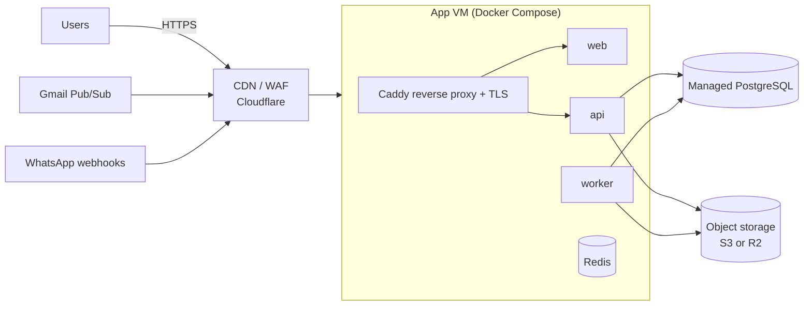
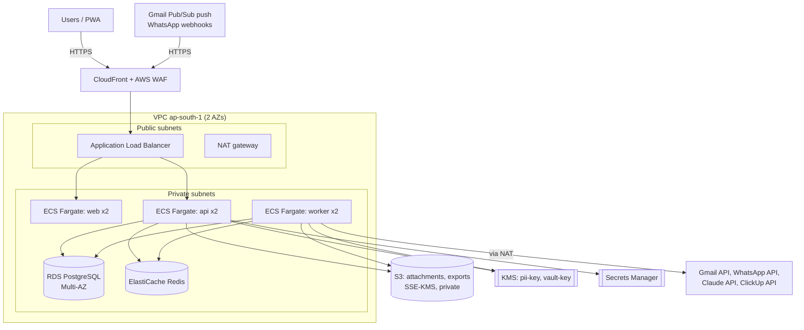
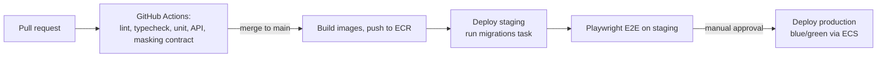

# SySpree Ops Hub - Hosting and Architecture Guide

Version 1.0 · 25 Oct 2026
Reads with: `02_TechSpec.md` (components), `04_QuickStart.md` (local setup).

**Recommendation:** host production on AWS in the Mumbai region (`ap-south-1`) with managed Postgres and Redis. Start on the Lean option only if the Phase 1 budget is tight, and move to the Standard option before cutover from ClickUp.

Replace `ops.example.com` everywhere with SySpree's chosen subdomain.

---

## 1. Environments

| Environment | Purpose | Data | URL |
| --- | --- | --- | --- |
| Local | Developer machines | Seed data only | `http://localhost:3000` |
| Staging | QA, UAT, ClickUp import dry runs | Seed + anonymised import | `https://staging.ops.example.com` |
| Production | Live use | Real client data | `https://ops.example.com` |

Rules: real client data never leaves production. Staging uses the anonymised import (names, emails, phones and credentials replaced). Production and staging use separate cloud accounts, separate KMS keys and separate Google Cloud and Meta apps.

---

## 2. Option A: Lean (MVP, lowest running cost)

One VM running Docker Compose for the app containers, with managed Postgres so the database is not on the same box.

- VM: 4 vCPU, 8 GB RAM, India region (AWS Lightsail Mumbai, or equivalent).
- Managed PostgreSQL with automated daily backups and point-in-time recovery.
- Redis runs in a container with AOF persistence (queues survive restarts).
- Fits ~50 users. Single point of failure on the VM; accept only for the pilot.

---

## 3. Option B: Standard (recommended for production)

| Component | Service | Starting size | Notes |
| --- | --- | --- | --- |
| Edge | CloudFront + AWS WAF | Managed rules + rate limit on `/webhooks/*` and `/auth/*` | TLS via ACM |
| Load balancer | ALB | 1 | Path routing: `/api/*` and `/rt/*` to api, rest to web; sticky sessions off, Socket.IO uses Redis adapter |
| Web | ECS Fargate | 2 tasks, 0.5 vCPU / 1 GB | Autoscale on CPU 60% |
| API | ECS Fargate | 2 tasks, 1 vCPU / 2 GB | Autoscale on CPU and request count |
| Worker | ECS Fargate | 2 tasks, 1 vCPU / 2 GB | Autoscale on queue depth |
| Database | RDS PostgreSQL 17, Multi-AZ | db.t4g.medium to start | Storage encrypted with KMS, PITR 30 days |
| Cache / queue | ElastiCache Redis 7 | cache.t4g.small, 1 replica | Encryption in transit and at rest |
| Files | S3 | Versioning on, Block Public Access on | Presigned URLs, 5 min expiry |
| Keys | KMS | `opshub-pii`, `opshub-vault` | Vault key usable only by api role, with reveal endpoint |
| Secrets | Secrets Manager | OAuth client secrets, WhatsApp app secret, Claude API key, ClickUp token | Rotated per section 8 |
| Images | ECR | One repo per app | Scan on push |
| Logs and metrics | CloudWatch + Sentry | 30-day log retention | PII-free logs |

**Why Mumbai.** The team and most traffic are in India, latency to UAE and Saudi clients is acceptable, and it keeps client data in India for DPDP Act comfort. PRD open question 8 (data residency) still needs a final answer, particularly for UK and Australian client contracts.

---

## 4. Network and security

- Only the ALB sits in public subnets. App tasks, RDS and Redis are private. Security groups allow ALB → web/api, api/worker → RDS/Redis, nothing else inbound.
- Outbound calls (Gmail, WhatsApp, Claude, ClickUp) leave through the NAT gateway. Optionally pin egress IPs for vendor allowlisting.
- Webhook endpoints are public by necessity. They verify signatures (Gmail Pub/Sub OIDC token audience check; WhatsApp `X-Hub-Signature-256`) and are rate limited at the WAF.
- Admin access to AWS uses SSO with MFA. No long-lived IAM user keys. Database access for humans is via a bastion-less SSM session to a short-lived task, logged.
- TLS 1.2+ everywhere; HSTS on the app domain.
- Each ECS service has its own IAM task role with least privilege. Only the api role may call `kms:Decrypt` on `opshub-vault`.

---

## 5. External setup checklist

**Google Cloud (needed even when hosting on AWS)**

1. Create a Google Cloud project per environment (`opshub-staging`, `opshub-prod`).
2. Enable Gmail API and Pub/Sub API.
3. OAuth consent screen: Internal (SySpree Workspace only). Scopes: `openid`, `email`, `profile`, `https://www.googleapis.com/auth/gmail.modify`.
4. Create OAuth client (web) with redirect `https://ops.example.com/api/v1/auth/callback` and `https://ops.example.com/api/v1/mailboxes/callback`.
5. Create Pub/Sub topic `gmail-push`, grant `gmail-api-push@system.gserviceaccount.com` publisher rights, create a push subscription to `https://ops.example.com/api/v1/webhooks/gmail` with OIDC auth.

**Meta / WhatsApp**

1. Meta Business portfolio verified; create a Meta app with the WhatsApp product.
2. Register the SySpree business phone number on the Cloud API (not the WhatsApp Business app, which cannot be used for the API).
3. Webhook URL `https://ops.example.com/api/v1/webhooks/whatsapp`, verify token from Secrets Manager, subscribe to `messages`.
4. Create message templates for out-of-window replies (welcome, approval request, monthly report ready).
5. Phase 2: apply for Official Business Account status before building Route A groups.

**Anthropic**

1. Create an organisation API key for production and a separate one for staging.
2. Set spend limits per key. Review the commercial data-use and retention terms before go-live.

**ClickUp**

1. Generate a personal API token from an Admin account for the import window only. Revoke it after cutover.

**DNS**

1. `ops.example.com` → CloudFront. `staging.ops.example.com` → staging CloudFront.
2. Add SPF/DKIM only if Ops Hub ever sends mail outside Gmail (not planned: mail goes through Gmail API).

---

## 6. CI/CD

- Migrations run as a one-off ECS task before the new app version takes traffic. Migrations must be backward compatible for one release (expand, then contract).
- Production deploy needs approval from Admin or the tech lead.
- Rollback: redeploy the previous task definition. Database rollbacks are forward fixes, never `migrate reset`.

---

## 7. Backup and disaster recovery

| Item | Method | Retention | Target |
| --- | --- | --- | --- |
| PostgreSQL | RDS automated snapshots + PITR | 30 days | RPO 15 min |
| PostgreSQL long-term | Monthly snapshot copied to a second region (`ap-southeast-1`) | 12 months | |
| S3 attachments | Versioning + lifecycle to Glacier after 180 days; cross-region replication | Indefinite | |
| Redis | Not a system of record; jobs replay from Postgres state | n/a | |
| Secrets and KMS | KMS keys with deletion protection; secrets backed up via IaC | n/a | |
| Restore drill | Quarterly restore to an isolated account, run smoke tests | | RTO 4 h |

---

## 8. Operations runbooks

| Runbook | Steps |
| --- | --- |
| Deploy | Merge → CI green → staging auto-deploy → E2E green → approve production |
| Roll back | ECS console or CLI: update service to previous task definition revision |
| Restore DB | Restore RDS to point in time into a new instance → verify → swap connection secret → restart api and worker |
| Rotate secrets | Every 90 days: Google OAuth client secret, WhatsApp app secret, Claude key. Update Secrets Manager → rolling restart |
| Gmail watch expired | Admin page shows mailbox status → "Re-watch" button, or run `gmail.watch.renew` job |
| WhatsApp webhook failing | Check WAF blocks and signature failure alert → confirm app secret matches → replay from Meta dashboard |
| Offboard a user | Admin deactivates user → sessions revoked → open tasks reassigned to TL → credential grants revoked → their personal mailbox disconnected |
| Suspected data exposure | Pull `AuditLog` for the period → revoke sessions → rotate vault data keys → notify Admin within 24 h (DPDP Act breach duties apply) |

---

## 9. Monitoring and alerts

| Signal | Threshold | Goes to |
| --- | --- | --- |
| API 5xx rate | over 1% for 5 min | Tech lead |
| API p95 latency | over 2 s for 10 min | Tech lead |
| Queue depth (`triage`, `gmail.sync`) | over 500 for 10 min | Tech lead |
| Dead-letter queue | any new item | Tech lead |
| Gmail watch | expires in under 24 h | Tech lead, Admin |
| WhatsApp signature failures | over 5 in 10 min | Tech lead |
| RDS CPU / storage | over 80% | Tech lead |
| Uptime check (`/healthz`) | 2 failures in a row during 9:00 to 21:00 IST | Tech lead, Admin |

---

## 10. Cost drivers

No prices here because they change; size these with the AWS calculator before approval.

- Fixed: RDS Multi-AZ, NAT gateway, ALB, ElastiCache. These dominate at 50 users.
- Variable: Claude API (one Haiku call per inbound client message, more on retries), WhatsApp per-message charges for template and group messages, S3 storage growth from attachments, CloudFront egress.
- Saving levers: single-AZ RDS on staging, Fargate Spot for workers, S3 lifecycle rules, caching triage results by message hash.

---

## 11. Infrastructure as code

Define everything (VPC, ECS, RDS, ElastiCache, S3, KMS, WAF, IAM) in Terraform under `infra/` with one workspace per environment. No console-only changes in production; drift is checked weekly.
